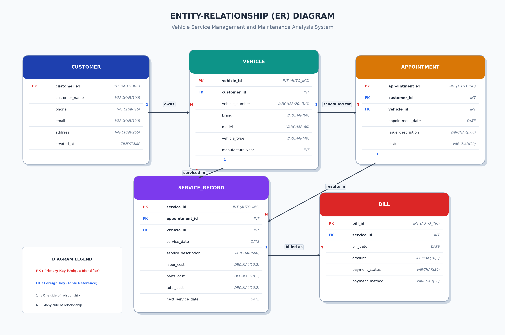
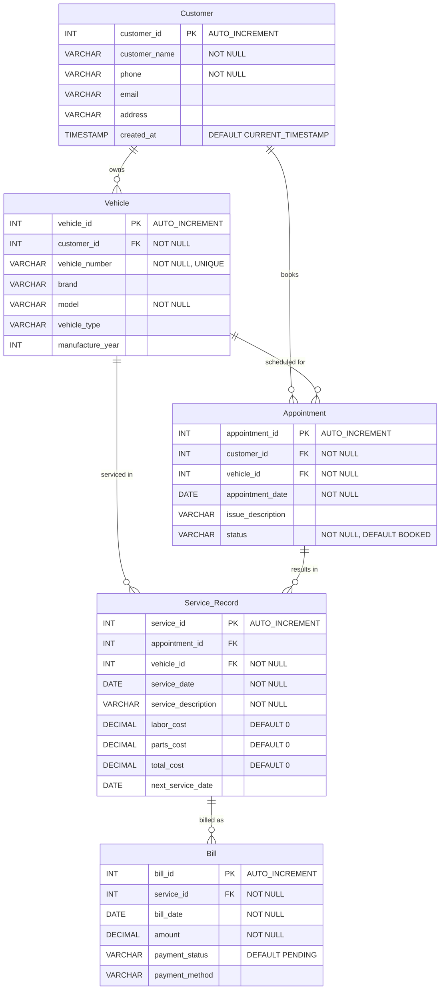

# ER Diagram – Vehicle Service Management and Maintenance Analysis System

This Entity-Relationship diagram illustrates the database schema for the Vehicle Service Management and Maintenance Analysis System. It covers five core entities and their relationships.

## Relationships

| Relationship | Type | Description |
|---|---|---|
| Customer → Vehicle | 1 : N | A customer can own multiple vehicles |
| Customer → Appointment | 1 : N | A customer can book multiple appointments |
| Vehicle → Appointment | 1 : N | A vehicle can have multiple appointments |
| Vehicle → Service_Record | 1 : N | A vehicle can have multiple service records |
| Appointment → Service_Record | 1 : N | An appointment can result in multiple service records |
| Service_Record → Bill | 1 : N | A service record can have one or more bills |
